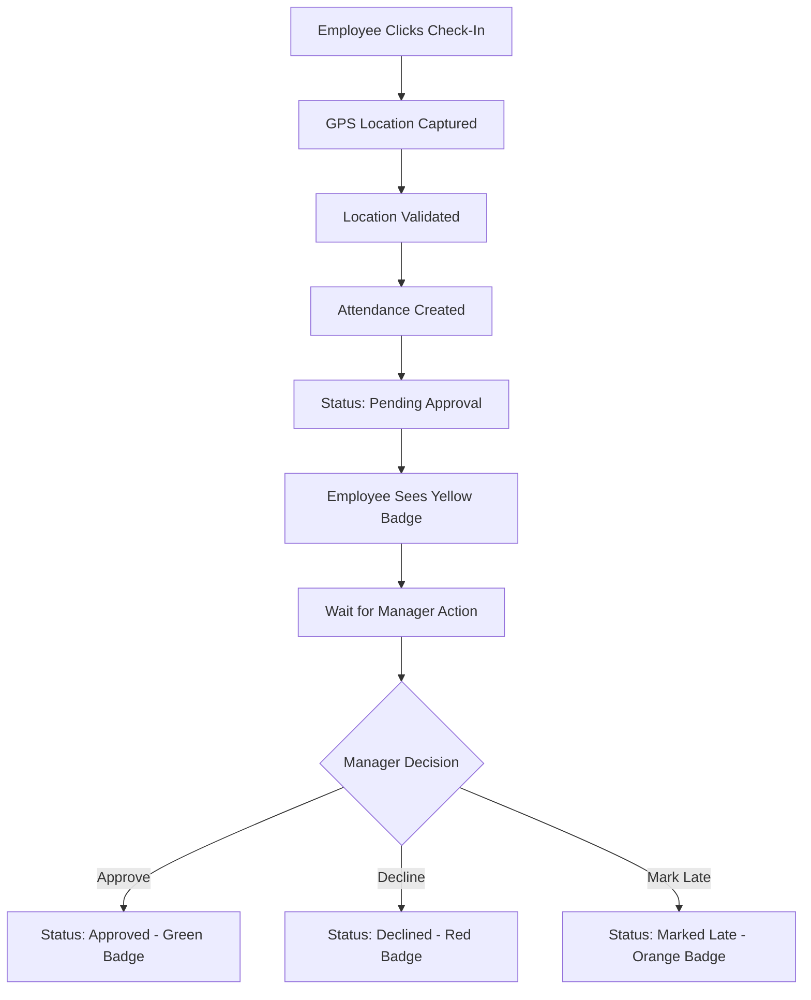
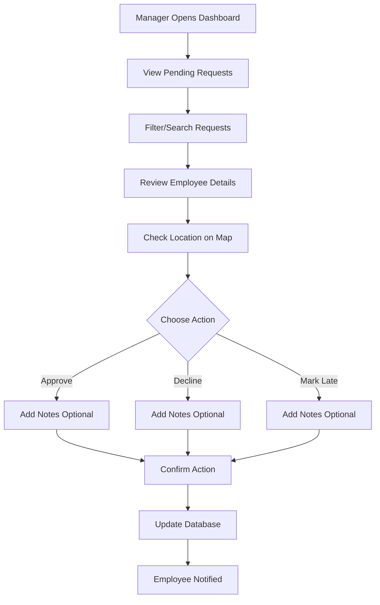

# 🎯 Manager Approval Workflow - Complete Implementation

## 📊 Project Overview

This implementation adds a **comprehensive Manager Approval Workflow** to the existing Attendance Management System. All employee check-ins now require manager approval before attendance is finalized.

---

## ✨ Key Features

### 🔹 Employee Side
- ✅ GPS-based check-in with location validation
- ✅ Automatic "Pending Approval" status
- ✅ Real-time status badges (Pending/Approved/Declined/Late)
- ✅ Manager notes visibility
- ✅ Beautiful, modern UI with animations

### 🔹 Manager Side
- ✅ Comprehensive approval dashboard
- ✅ Advanced filtering (search, status, date)
- ✅ Employee details with Google Maps integration
- ✅ Three action types: Approve, Decline, Mark Late
- ✅ Optional notes for each action
- ✅ Action logging with timestamps
- ✅ Premium UI/UX with smooth animations

---

## 🗂️ Project Structure

```
SmartCMS/
├── backend/
│   ├── models/
│   │   └── Attendance.js          ✅ Updated with approval fields
│   └── routes/
│       └── attendance.js          ✅ Added 5 new endpoints
│
├── smart-cms/
│   └── src/app/
│       ├── services/
│       │   └── attendance.service.ts    ✅ Updated with approval methods
│       ├── dashboard/
│       │   ├── attendance/
│       │   │   ├── attendance.component.ts
│       │   │   └── attendance.component.html    ✅ Added status badges
│       │   ├── manager-approvals/           🆕 NEW COMPONENT
│       │   │   ├── manager-approvals.component.ts
│       │   │   ├── manager-approvals.component.html
│       │   │   └── manager-approvals.component.css
│       │   └── components/
│       │       └── sidebar/
│       │           └── sidebar.component.ts    ✅ Added navigation link
│       └── app.routes.ts                      ✅ Added new route
│
├── MANAGER_APPROVAL_WORKFLOW.md     📖 Full documentation
├── IMPLEMENTATION_SUMMARY.md        📋 Implementation details
├── QUICK_START.md                   🚀 Quick start guide
└── README_MANAGER_APPROVAL.md       📘 This file
```

---

## 🎨 UI/UX Screenshots

### Manager Approval Dashboard


**Features:**
- Modern dark theme with blue accents
- Card-based layout for each request
- Real-time search and filtering
- Action buttons with color coding
- Google Maps integration
- Smooth animations and transitions

### Employee Attendance View


**Features:**
- Status badges with color coding
- Pulsing animation for pending status
- Manager notes display
- Clean, modern interface
- Responsive design

---

## 🔌 API Endpoints

### 1. Get Pending Approvals
```
GET /api/attendance/pending-approvals
Query: ?limit=50&skip=0
Auth: Required (Manager)
```

### 2. Approve Attendance
```
POST /api/attendance/approve/:attendanceId
Body: { "notes": "Optional notes" }
Auth: Required (Manager)
```

### 3. Decline Attendance
```
POST /api/attendance/decline/:attendanceId
Body: { "notes": "Optional notes" }
Auth: Required (Manager)
```

### 4. Mark as Late
```
POST /api/attendance/mark-late/:attendanceId
Body: { "notes": "Optional notes" }
Auth: Required (Manager)
```

### 5. Get Approval History
```
GET /api/attendance/approval-history
Query: ?limit=30&skip=0
Auth: Required (Manager)
```

---

## 💾 Database Schema

### Attendance Collection (MongoDB)

```javascript
{
  _id: ObjectId,
  employeeId: String,              // Reference to User
  date: Date,
  checkIn: {
    time: Date,
    location: {
      latitude: Number,
      longitude: Number
    },
    address: String,
    distance: Number,
    officeLocation: ObjectId       // Reference to OfficeLocation
  },
  checkOut: {
    time: Date,
    location: {
      latitude: Number,
      longitude: Number
    },
    address: String
  },
  status: String,                  // 'present' | 'absent' | 'late' | 'half-day'
  workingHours: Number,
  
  // 🆕 NEW: Manager Approval Fields
  approvalStatus: String,          // 'pending' | 'approved' | 'declined' | 'marked_late'
  approvedBy: String,              // Manager's employee ID
  approvedAt: Date,                // Timestamp of approval action
  managerNotes: String,            // Optional notes (max 500 chars)
  
  createdAt: Date,
  updatedAt: Date
}
```

---

## 🎯 User Workflows

### Employee Workflow



### Manager Workflow



---

## 🎨 Design System

### Color Palette

| Element | Color | Hex Code | Usage |
|---------|-------|----------|-------|
| Background | Dark Navy | #101935 | Main background |
| Card Background | Navy Blue | #1B264F | Card containers |
| Primary | Blue | #3083DC | Buttons, accents |
| Success | Emerald | #10b981 | Approved status |
| Warning | Orange | #f97316 | Late status |
| Error | Red | #ef4444 | Declined status |
| Pending | Yellow | #facc15 | Pending status |
| Text Primary | White | #ffffff | Main text |
| Text Secondary | Slate | #94a3b8 | Secondary text |

### Typography

- **Headers:** Bold, 24-32px
- **Body:** Medium, 14-16px
- **Labels:** Bold, 10-12px, Uppercase
- **Font Family:** System UI, Sans-serif

### Spacing

- **Small:** 4px, 8px
- **Medium:** 12px, 16px
- **Large:** 24px, 32px
- **XLarge:** 48px, 64px

---

## 🚀 Getting Started

### Prerequisites
- Node.js v16+
- MongoDB running
- Angular CLI

### Installation

1. **Clone the repository**
```bash
git clone <repository-url>
cd SmartCMS
```

2. **Install backend dependencies**
```bash
cd backend
npm install
```

3. **Install frontend dependencies**
```bash
cd smart-cms
npm install
```

4. **Start MongoDB**
```bash
mongod
```

5. **Start backend server**
```bash
cd backend
npm start
# Server runs on http://localhost:3000
```

6. **Start frontend**
```bash
cd smart-cms
npm start
# App runs on http://localhost:4200
```

### Access Points

- **Manager Dashboard:** `http://localhost:4200/dashboard/manager-approvals`
- **Employee Attendance:** `http://localhost:4200/dashboard/attendance`
- **API Base URL:** `http://localhost:3000/api`

---

## 🧪 Testing

### Manual Testing Checklist

#### Employee Side
- [ ] Check-in creates pending status
- [ ] Yellow "Pending" badge appears
- [ ] Location is captured correctly
- [ ] Distance is calculated accurately
- [ ] Status updates after manager action
- [ ] Manager notes are displayed
- [ ] All status badges show correct colors

#### Manager Side
- [ ] Pending requests load correctly
- [ ] Search by name works
- [ ] Search by employee ID works
- [ ] Search by department works
- [ ] Status filter works
- [ ] Date filter works
- [ ] Approve action works
- [ ] Decline action works
- [ ] Mark Late action works
- [ ] Notes are saved correctly
- [ ] Map link opens correctly
- [ ] Modal opens/closes properly
- [ ] Success messages appear
- [ ] Error handling works
- [ ] Loading states display

### Test Scenarios

**Scenario 1: Happy Path**
1. Employee checks in → Status: Pending
2. Manager approves → Status: Approved
3. Employee sees green badge

**Scenario 2: Late Arrival**
1. Employee checks in late → Status: Pending
2. Manager marks as late → Status: Marked Late
3. Employee sees orange badge

**Scenario 3: Invalid Check-in**
1. Employee checks in from wrong location → Status: Pending
2. Manager declines → Status: Declined
3. Employee sees red badge

---

## 🔐 Security

### Authentication
- JWT token required for all endpoints
- Token stored in localStorage
- Automatic token refresh

### Authorization
- Role-based access control
- Managers can access approval dashboard
- Employees can only view their own attendance
- Actions logged with manager ID

### Data Validation
- Input sanitization
- Notes limited to 500 characters
- Status transitions validated
- One-time approval enforcement

---

## 📱 Responsive Design

### Breakpoints
- **Mobile:** < 768px
- **Tablet:** 768px - 1024px
- **Desktop:** > 1024px

### Mobile Optimizations
- Stacked card layout
- Touch-friendly buttons (min 44px)
- Simplified navigation
- Optimized images
- Reduced animations

---

## 🎁 Additional Features

### Implemented
✅ Real-time search and filtering
✅ Google Maps integration
✅ Action logging with timestamps
✅ Success/error notifications
✅ Loading states
✅ Smooth animations
✅ Responsive design
✅ Keyboard navigation
✅ Error handling

### Future Enhancements
🔮 Email notifications
🔮 Bulk approve/decline
🔮 Analytics dashboard
🔮 Auto-approval rules
🔮 Export to CSV/PDF
🔮 Mobile app
🔮 Push notifications
🔮 Attendance reports
🔮 Shift time validation
🔮 Geofencing alerts

---

## 📚 Documentation

- **Full Documentation:** [MANAGER_APPROVAL_WORKFLOW.md](./MANAGER_APPROVAL_WORKFLOW.md)
- **Implementation Summary:** [IMPLEMENTATION_SUMMARY.md](./IMPLEMENTATION_SUMMARY.md)
- **Quick Start Guide:** [QUICK_START.md](./QUICK_START.md)

---

## 🐛 Troubleshooting

### Common Issues

**Issue:** Manager dashboard not loading
**Solution:** Check JWT token, verify manager role, check backend connection

**Issue:** Approval action fails
**Solution:** Verify attendance ID, check manager permissions, review backend logs

**Issue:** Status not updating
**Solution:** Refresh page, check API calls, clear browser cache

**Issue:** Location not accurate
**Solution:** Enable high accuracy GPS, check browser permissions, verify coordinates

---

## 📞 Support

For issues or questions:
1. Check documentation files
2. Review browser console
3. Check backend logs
4. Verify database connection
5. Test API endpoints with Postman

---

## 🎊 Credits

**Developed by:** Your Development Team
**Date:** January 30, 2026
**Version:** 1.0.0
**Status:** ✅ Production Ready

---

## 📄 License

[Your License Here]

---

## 🎉 Conclusion

The Manager Approval Workflow is now fully implemented with:
- ✅ Complete backend API
- ✅ Beautiful, modern UI
- ✅ Real-time updates
- ✅ Secure authentication
- ✅ Comprehensive error handling
- ✅ Smooth animations
- ✅ Responsive design
- ✅ Complete documentation

**Ready to use! 🚀**

Access the manager dashboard at: `/dashboard/manager-approvals`

---

**Happy Coding! 💻**
